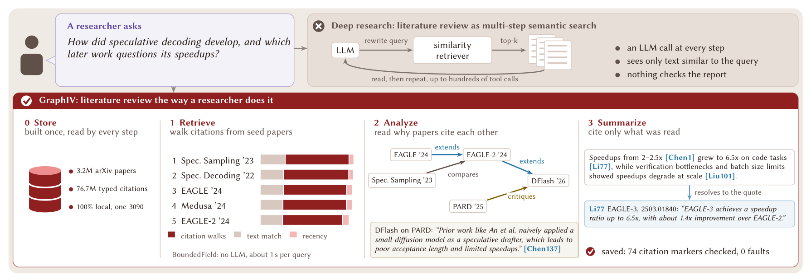

# GraphIV: a rich, open source, and updating citation graph of arXiv

[](https://graphiv.kuroma.dev)
[](https://huggingface.co/datasets/kkuroma/GraphIV)
[](https://huggingface.co/datasets/kkuroma/GraphIV_benchmarks)
[](https://huggingface.co/kkuroma/GraphIV-citation-intent)
[](https://huggingface.co/kkuroma/GraphIV-survey)
[](LICENSE)

GraphIV ("graph" + arXiv) is a free and open source citation graph of 3.2 million arXiv papers and 76.7 million resolved citations labeled by intent, rebuilt every two weeks on a single PC. 

This work also presents **BoundedField**, a citation-aware, LLM-free retriever, and **GraphIV-MCP**, a set of locally hostable tools for completely local deep search on a single RTX 3090.

I designed GraphIV originally to catch up with how fast AI/ML research updates, which has itself developed into a research project. My ultimate goal is to scale in both volume (how big the database is) and resolution (how detailed are the contents in the database) beyond just arXiv, while keeping the recipe open source for transparency and reproducability.



## Components

| Component | Description | Documentations |
| --- | --- | --- |
| GraphIV | A frequently updating database of arXiv with citation intent, survey probability, and named topic tree | [`docs/01_preprocessing.md`](docs/01_preprocessing.md) |
| SurveyMatch, FrontierMatch, ConsensusMatch | Three benchmarks generated from arXiv's own citations | [`docs/01_preprocessing.md`](docs/01_preprocessing.md#benchmarks) |
| BoundedField | A citation-aware, LLM-free, and tuneable retriever and the main focus of this work | [`docs/02_retrieval.md`](docs/02_retrieval.md) |
| GraphIV-MCP | A suite of six MCP tools for automated deep research via CLI coding agents | [`docs/03_tools.md`](docs/03_tools.md) |

## Results

BoundedField outperformed BM25, dense retrievers, a reranker and two graph baselines at most cutoffs, at about one second per query, and elevates a 475M-parameter embedder's performance to that of larger ones up to 27B parameters. Recall on the test splits, all on the Nomic embedding:

| method | SurveyMatch R@200 | FrontierMatch R@50 | ConsensusMatch R@50 | AutoScholarQuery R@50 | SurGE R@200 |
| --- | --- | --- | --- | --- | --- |
| BM25 | 0.100 | 0.051 | 0.113 | 0.313 | 0.192 |
| Nomic cosine | 0.133 | 0.069 | 0.172 | 0.375 | 0.255 |
| PPR | 0.229 | 0.077 | 0.441 | 0.482 | 0.387 |
| **BoundedField** | **0.319** | **0.139** | **0.624** | **0.612** | **0.451** |

All 63 test runs of the research agent, 21 questions at three efforts, passed the mechanical check, which stopped 61 of the 63 first drafts, and every one is public on [graphiv.kuroma.dev](https://graphiv.kuroma.dev) with its report, its calls and the agent's reasoning.

## Using GraphIV

The tables are on [Hugging Face](https://huggingface.co/datasets/kkuroma/GraphIV), gated behind CC BY-NC 4.0, and the dataset card covers the columns and how to query them. To run the tools on your own machine:

```sh
nix develop                                               # Python 3.13, uv, postgres17 with pgvector
uv sync
uv run python scripts/serve.py --http --role api          # the six tools, at http://127.0.0.1:6767/mcp
uv run python scripts/serve.py --http --role frontend     # the webui over saved runs, at http://127.0.0.1:6969
claude mcp add --transport http graphiv http://127.0.0.1:6767/mcp
```

The server needs the store, built by the stages of [`docs/01_preprocessing.md`](docs/01_preprocessing.md), an embedding endpoint serving nomic-embed-text-v2-moe through llama-server, and any OpenAI-compatible chat endpoint. Every path, port and endpoint is a key of [`config.toml`](config.toml). On NixOS, `services.graphiv` runs the store, the tools, the webui and the manager as units, and [`nix/README.md`](nix/README.md) is its page.

## Repository Layout

| Path | Content |
| --- | --- |
| [`src/`](src/README.md) | Library: [`core`](src/core/README.md), [`retrieve`](src/retrieve/README.md) (BoundedField), [`miner`](src/miner/README.md) (LeyLine), [`report`](src/report/README.md), [`mcp`](src/mcp/README.md) and [`webui`](src/webui/README.md) |
| [`scripts/`](scripts/README.md) | Downloader, Labelers, HF Exports, GUI manager, and  `serve.py` |
| [`retrieval_recipes/`](retrieval_recipes) | Tuned exponent for each search mode in TOML. Created by `benchmarks/tune.py` |
| [`benchmarks/`](benchmarks/README.md) | Source code for the comparison against other works. |
| [`paper/`](paper/scripts/README.md) | Paper and source code that generates the figures |
| [`assets/`](assets/README.md) | Figures used in the dosc and code that generates them |
| [`docs/`](docs/README.md) | Documentations |
| [`nix/`](nix/README.md) | Packaging and NixOS module |
| [`themes/`](themes/README.md) | Central directory for color and font themes |

## Acknowledgments

Thank you to arXiv for use of its open access interoperability. GraphIV is built on [arXiv's metadata snapshot on Kaggle](https://www.kaggle.com/datasets/Cornell-University/arxiv), on [arXiv](https://arxiv.org)'s own HTML renders and its PDF bucket on Google Cloud, and on [ar5iv](https://ar5iv.labs.arxiv.org) for the papers from before arXiv rendered HTML itself. Thank you to Charin Polpanumas (CStorm125) for their assistance in generating the Qwen, Harrier and Nemotron embeddings.

| model | used for |
| --- | --- |
| [nomic-ai/nomic-embed-text-v2-moe](https://huggingface.co/nomic-ai/nomic-embed-text-v2-moe), served from [its GGUF](https://huggingface.co/nomic-ai/nomic-embed-text-v2-moe-GGUF) | every embedding |
| Wordslop-Qwen3.6-27B | the research agent, and every model call of the tools |
| [google/gemma-4-26B-A4B-it](https://huggingface.co/google/gemma-4-26B-A4B-it) | the topic names, both labelers' training labels and the benchmark questions |
| [Qwen/Qwen3.6-35B-A3B](https://huggingface.co/Qwen/Qwen3.6-35B-A3B) and [zai-org/GLM-4.7-Flash](https://huggingface.co/zai-org/GLM-4.7-Flash) | checking the survey labels against two other model families |
| [distilbert/distilbert-base-uncased](https://huggingface.co/distilbert/distilbert-base-uncased) | both labelers |

## License

| Component | License |
| --- | --- |
| Code in this repository | [AGPLv3](LICENSE) |
| Dataset and benchmarks | CC BY-NC 4.0. The columns from CC0 remains as such |
| Labelers | Apache 2.0 |

The code is AGPLv3 from the commit after `c484e9a`, and every commit up to and including `c484e9a` was released under GPLv3.

## Citation

```bibtex
@misc{graphiv2026,
  title={GraphIV: An Updated, Open Citation Intent Graph of arXiv for Citation-Aware Retrieval and Automated Research Agents},
  author={Thuwajit, KK},
  year={2026},
  howpublished={\url{https://git.kuroma.dev/kkuroma/graphiv}}
}
```
