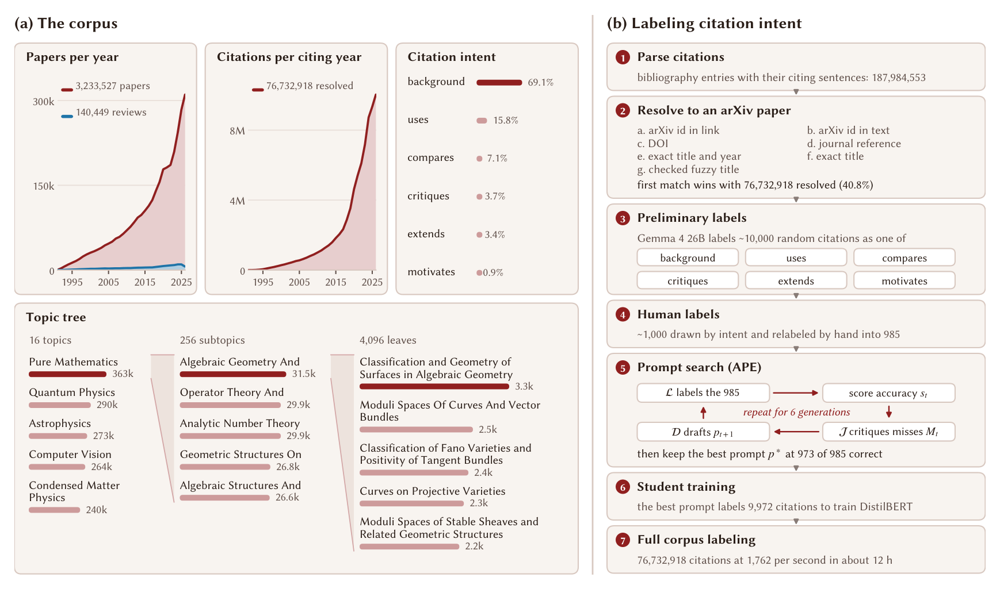
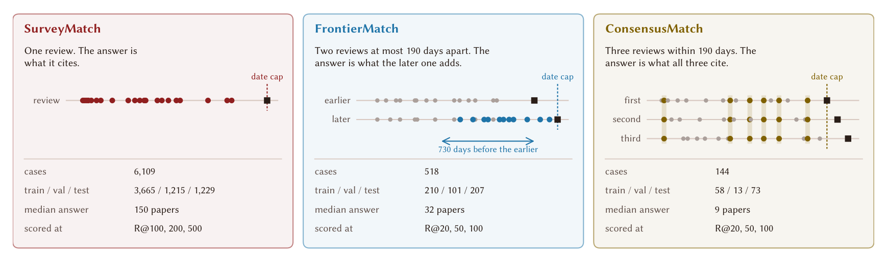

# Preprocessing

GraphIV (Graph + arXiv) is an open citation intent graph of arXiv, and this page covers how it is built and how the benchmarks are mined from it. To keep GraphIV self-hostable, everything was built and tested on one consumer machine: an AMD Ryzen 7 7700X, 64 GB of memory, and an NVIDIA RTX 3090.



## Sources

GraphIV is built from Cornell's [arXiv metadata snapshot on Kaggle](https://www.kaggle.com/datasets/Cornell-University/arxiv), which is free and updated biweekly. Each alternative misses one of these: Semantic Scholar's bulk datasets require an API key, OpenAlex's free snapshot is quarterly and its daily one paid, and unarXive, the closest predecessor, is frozen at 2022. As the snapshot holds only per-paper metadata, I built the citation graph from arXiv's open HTML renders, with [ar5iv](https://ar5iv.labs.arxiv.org) for the papers from before arXiv rendered HTML itself.

As of 2026-11-11, the corpus held 3,233,527 papers, 3,196,302 of them processed.

| Input | Config key | Note |
| --- | --- | --- |
| Metadata snapshot | `[source] SOURCE_URL` | Source Kaggle arXiv snapshot (~5.6 GB JSON) |
| PDF mirror | `[source] PDF_BASE_URL` | Google's arxiv-dataset bucket |
| HTML renders | `[source] HTML_BASE_URL`, `HTML_FALLBACK_URL` | arXiv's own render (ar5iv before 2024-01) |
| Embedding endpoint | `[endpoints] EMBEDDING_ENDPOINT` | OpenAI compatible (uses `/tokenize`) |
| LLM endpoint | `[endpoints] LLM_ENDPOINT` | Any OpenAI-compatible host, for naming the topics |
| Disk | `[dataset] PDF_PATH`, `HTML_PATH` | 5.6 TB PDF, 496 GB HTML and about 90 GB of Postgres |

Every other path and default is a key of [`config.toml`](../config.toml), and every script takes `--config_path`.

## Building the database

The central database use PostgreSQL with pgvector holding `papers`, `citations`, `topic_tree` and `topic_names`. Creating the database can be broken down into three phases under [`scripts/`](../scripts/README.md). Run this in order to recreate the whole database in the same manner it was created here.

```sh
nix develop
uv sync
nix run .#pg-start

P=scripts/papers_preprocess
T=scripts/topic_tree_creation
C=scripts/citation_preprocess

uv run python $P/stage0_fetch_source_json.py --dry-run   # what a new snapshot adds, touching nothing
uv run python $P/stage0_fetch_source_json.py --no-fetch
uv run python $P/stage1_download_pdf.py
uv run python $P/stage2_download_html.py
uv run python $P/stage3_embed_papers.py
uv run python $P/stage4_label_survey.py

uv run python $T/stage0_umap.py
uv run python $T/stage1_create_topic_tree.py
uv run python $T/stage2_topic_labeling.py

uv run python $C/stage0_create_citation.py --workers 16
uv run python $C/stage1_label_citation.py
uv run python $C/stage2_export_graph.py
```

`papers_preprocess` starts first, and subsequent steps checks for `papers.stage >= 3` and writes only to its own tables, meaning the topic tree and citation resolver can be run in parallel. The topic tree is fit on every rebuild while everything else only processes the delta. On NixOS, the manager ([`scripts/graphiv_manager/`](../scripts/graphiv_manager/README.md)) fetches the snapshot, forecasts what it adds and runs every stage as a job.

### Restoring from a dump

The manager's Export tab writes a full `pg_dump` of the store into `[export] EXPORT_PATH`, through [`stage0_dump_store.py`](../scripts/export/stage0_dump_store.py), which skips the build entirely. The publicly released backup does not store the citation sentence as per arXiv's own license.

```sh
nix run .#pg-init
nix run .#pg-start
pg_restore -h ./.pg -p 5433 -d arxivkg --no-owner --jobs 4 graphiv-<date>.dump
uv run python scripts/citation_preprocess/stage2_export_graph.py
```

`pg_restore` rebuilds the HNSW index from scratch. As a fresh cluster from `pg-init` trusts every connection over its own socket, create a user and group for GraphIV prior to hosting.

## Citation Extraction and Resolution

For each paper with an HTML version, [`stage0_create_citation.py`](../scripts/citation_preprocess/stage0_create_citation.py) parses the citations using the strategies below. Of 187,984,553 parsed citations, 76,732,918 (40.8%) resolved to a paper in the corpus. The numbers below are the citations each method resolved on top of those before it.

| Method | Number of resolved citations |
| --- | --- |
| arXiv id in the text | 21,831,361 |
| Exact title and year | 16,478,534 |
| Journal reference | 13,397,614 |
| arXiv id in the link | 10,058,637 |
| Fuzzy title | 8,491,441 |
| DOI | 4,108,520 |
| Exact title, year disagrees | 2,366,811 |
| **resolved** | **76,732,918** |
| Fuzzy match rejected | 18,253,288 |
| No match | 92,998,347 |
| **parsed** | **187,984,553** |

## Citation Intent

Each citation is classified into one of six intents. Existing classifiers are coarser: SciCite uses background, method and result comparison, while ACL-ARC and MultiCite separate extending from comparing but fold critiques into comparison. I kept `critiques` separate since, with `extends` and `compares`, it forms what the lineage tracing follows ([`03_tools.md`](03_tools.md#leyline)).

| Intent | The citing paper | Share |
| --- | --- | --- |
| `background` | Cites it for general context, or as related work | 69.1% |
| `uses` | Applies its method, data or tool unchanged | 15.8% |
| `compares` | Sets its results against it, or agrees with it | 7.1% |
| `critiques` | Names a flaw, a limitation or a disagreement | 3.7% |
| `extends` | Builds on, generalizes or modifies it | 3.4% |
| `motivates` | Was inspired by it | 0.9% |

As labeling 76.7 million citations with an LLM on one GPU is not computationally realistic, I distilled one into a small classifier, in [`scripts/citation_labeler/`](../scripts/citation_labeler/README.md). Gemma 4 26B labeled 10,000 random citations, from which a stratified sample of about 1,000 was relabeled by hand, leaving 985 human-labeled citations $\{(x_i, y_i)\}_{i=1}^{n}$. Against these, I ran automatic prompt engineering: at generation $t$, the labeler $\mathcal{L}$ labels every citation under prompt $p_t$, the judge $\mathcal{J}$ critiques $p_t$ from its misses alone, and the drafter $\mathcal{D}$ writes the next prompt from the critique.

$$
\begin{aligned}
\hat{y}_{i,t} &= \mathcal{L}(x_i, p_t) && \text{labeler} \\
s_t &= \frac{1}{n} \sum_{i=1}^{n} \mathbb{1}\left[\hat{y}_{i,t} = y_i\right] && \text{score} \\
c_t &= \mathcal{J}\left(p_t, \left\{(x_i, y_i, \hat{y}_{i,t}) : \hat{y}_{i,t} \neq y_i\right\}\right) && \text{judge} \\
p_{t+1} &= \mathcal{D}(p_t, c_t) && \text{drafter} \\
p^{\ast} &= p_{\operatorname{arg\,max}_{t} s_t} && \text{selection}
\end{aligned}
$$

Unparsable replies count as misses, and the judge sees at most 60 misses per generation. After six generations, $p^{\ast}$ labeled 973 of the 985 correctly, and then labeled about 10,000 fresh citations to train a DistilBERT student at an 8:1:1 split.

| Student | Accuracy | Macro F1 |
| --- | --- | --- |
| Against the teacher, 998 test citations | 0.886 | 0.815 |
| Against the 985 human labels, never trained on | 0.981 | 0.981 |
| The teacher against the 985 human labels | 0.988 | 0.988 |

At 1,762 citations per second on the 3090, the student labeled the corpus in 12 hours. The model and its full evaluation are on [GraphIV-citation-intent](https://huggingface.co/kkuroma/GraphIV-citation-intent).

## Survey Detection

Reviews' reference lists are the answer keys of the benchmarks below. A title regex over "survey", "review" and nine other words reached a recall of 0.185 at 0.409 precision, as 81% of reviews carry none of them. Instead, a second DistilBERT reads the title and abstract, trained on 24,000 papers labeled by Gemma 4 26B, half with a review word in the title. It reached 0.878 average precision against the LLM labels, and 140,449 papers scored above 0.5. It runs in [`stage4_label_survey.py`](../scripts/papers_preprocess/stage4_label_survey.py), and the model is [GraphIV-survey](https://huggingface.co/kkuroma/GraphIV-survey).

## Embeddings

By default, every title and abstract is embedded by [nomic-embed-text-v2-moe](https://huggingface.co/nomic-ai/nomic-embed-text-v2-moe) into 768 dimensions, truncated to 512 tokens, at 185 papers per second, or 5 hours for the corpus, in [`stage3_embed_papers.py`](../scripts/papers_preprocess/stage3_embed_papers.py). The embedder is off the shelf by design, so it can be swapped: the 3,186,931 papers of the 2026-10-01 release were also embedded with seven open embedders from 0.6B to 27B parameters, Qwen3-Embedding 0.6B, 4B and 8B, Harrier-OSS-v1 0.6B and 27B, and Nemotron-3-Embed 1B and 8B, each with its own document and query prompts. [`02_retrieval.md`](02_retrieval.md#over-off-the-shelf-embedders) compares them.

## Topic Tree

Each embedding is projected to 50 dimensions with UMAP and clustered with $k$-means three times at $k = 16$, giving 16 topics, 256 subtopics and 4,096 leaves, in [`scripts/topic_tree_creation/`](../scripts/topic_tree_creation/README.md). Gemma 4 26B names each node from the ten children, or papers for a leaf, nearest its centroid.

## The Release

The tables are published on [kkuroma/GraphIV](https://huggingface.co/datasets/kkuroma/GraphIV), with one tag per rebuild named by its newest paper, by [`scripts/export/`](../scripts/export/README.md). The release omits the citing sentences, since they are the citing paper's own text, and is 6.7 GB of Parquet. Its card covers the columns and how to query them.

## Benchmarks

I evaluated retrieval on five existing benchmarks from three sources and three of my own, capping every case at the date its answer key was drawn.

### Existing Benchmarks

| Benchmark | Cases | Scored at |
| --- | --- | --- |
| PaSa's AutoScholarQuery | 29,886 train, 901 validation and 899 test queries | R@20, R@50, R@100 |
| PaSa's RealScholarQuery | 49 queries | R@20, R@50, R@100 |
| SurGE | 193 surveys, matched by title as SurGE carries no arXiv ids | R@100, R@200, R@500 |
| ScholarCatalyst | 207 core and 687 subfield queries, scored inside its own corpus | nDCG@20, R@5, R@20, R@100 |

PaSa's queries are kept when all their answers are in GraphIV.

### Proposed Benchmarks

Existing benchmarks fall short of real literature research in three ways: most pair a query with a few papers while a review cites over 100, their keys are chosen by annotators or LLMs rather than by researchers for their own work, and each case comes from a single source paper. I addressed all three by mining benchmarks from GraphIV's own reviews, whose reference lists are large keys written by researchers. The topic tree and the survey classifier also let me group several reviews of one topic into a case, to ask what a field added over time and what it agrees on.



> **Definition (review).** A review is a paper with a survey probability of at least $0.95$, where the classifier's precision is $0.937$, placed in a leaf of the topic tree.

> **Definition (references).** The references $R(s)$ of a review $s$ are the papers it cites that resolve in GraphIV and predate it.

Gemma 4 26B writes each case's research question once from the titles, without naming any system, dataset or author, and the question is frozen in the release.

> **Definition (SurveyMatch).** What does a review cite? A case is one review $s$ with $|R(s)| \ge 100$. The answer is $R(s)$, and the cap is $s$'s date.

> **Definition (FrontierMatch).** What did a field pick up over a short period? A case is two reviews $s_1, s_2$ in one leaf, $s_2$ at most $190$ days after $s_1$, at a cosine of at least $0.80$. The answer is $\{ p \in R(s_2) \setminus R(s_1) : p \text{ dated no earlier than } 730 \text{ days before } s_1 \}$, kept when it holds 10 or more papers, and the cap is $s_2$'s date. The question is written from $s_1$ alone, so a case asks what the later review added to where the earlier one left the topic.

> **Definition (ConsensusMatch).** What does every review of a topic agree on? A case is three reviews $s_1, s_2, s_3$ in one leaf within $190$ days, each pair at a cosine of at least $0.75$. The answer is $R(s_1) \cap R(s_2) \cap R(s_3)$ dated on or before the first of them, kept when it holds 5 or more papers, and the cap is the first review's date.

| Benchmark | Cases | Train / Val / Test | Median answer | Recall@K|
| --- | --- | --- | --- | --- |
| SurveyMatch | 6,109 | 3,665 / 1,215 / 1,229 | 150 | R@100, R@200, R@500 |
| FrontierMatch | 518 | 210 / 101 / 207 | 32 | R@20, R@50, R@100 |
| ConsensusMatch | 144 | 58 / 13 / 73 | 9 | R@20, R@50, R@100 |

The counts are from the 2026-10-22 release, published on [kkuroma/GraphIV_benchmarks](https://huggingface.co/datasets/kkuroma/GraphIV_benchmarks). Cases are split by hashing their sorted anchor ids under the seed 69420, so a newer release is strictly additive and a case keeps its split whatever else is mined. A retriever scoring a case removes every paper dated after the cap and every one of the case's own reviews. The cases are mined and exported by [`stage2_export_benchmarks.py`](../scripts/export/stage2_export_benchmarks.py), and the recipes are tuned and scored on them by [`benchmarks/`](../benchmarks/README.md).

## Limitations

- GraphIV covers only arXiv, and parses only papers with an HTML render, so 59.2% of parsed citations point outside it or match nothing.
- The citation intents, review scores and topic names were produced by LLMs or classifiers distilled from one, with only 985 citations labeled by a human, so their errors propagate into everything built on them.
- Gemma 4 26B also wrote the benchmark questions, and about 6% of the papers the review classifier accepts at 0.95 are not reviews.
- Every answer is a paper a later review cited, so the benchmarks reward work already being noticed, and a paper too new to be cited cannot be an answer.
- Two reviews on one topic written within three months agree at recall 0.265 over 93 pairs, so past a point a higher score means matching one author's selection more than the field's.
