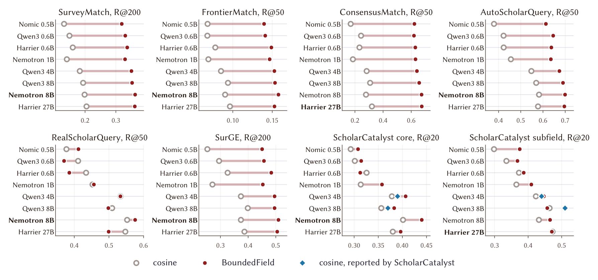

# Retrieval (BoundedField)

BoundedField is GraphIV's retriever and reranker: LLM-free, citation-aware, and tunable per task.

As human researchers leverage the citations to curate a literature list, BoundedField does the same. It takes the papers most similar to a question as the core, expands the pool with their citations, and scores each candidate as a product of bounded citation-walk terms whose exponents are fitted per task. It needs no LLM training or invocation, its scoring runs entirely on the CPU, and it is compatible with any off-the-shelf embedding model, so it is a cheap performance uplift over whatever embedder sits underneath it.

P.S. I named it after Fate/Type-Moon's bounded field, a ward drawn around a territory. The retrieval similarly draws the bounds of a research field around a question, bounding each term in $[0, 1]$, and runs [LeyLine](03_tools.md#leyline) inside the field it draws.

The code is [`src/retrieve/`](../src/retrieve/README.md), and the experiments behind every number here are [`benchmarks/`](../benchmarks/README.md).

## The Pool and the Core

> **Definition (pool, core).** Let $q$ be the question's embedding, $t$ the date the corpus is capped at, and $\cos(q, p)$ the cosine between $q$ and paper $p$'s embedding. The retriever takes the $5{,}000$ papers dated on or before $t$ with the highest $\cos(q, p)$. The **core** is the top $200$ of them, and expanding the list by one citation hop to and from the core gives the **pool** $P$.

An expander only appends papers, never removing what is already in the pool, and each hop keeps at most $20{,}000$ papers. A paper that is neither among the 5,000 nearest nor one hop from the core can never be ranked, which sets the ceiling of every recipe.

## Walking the Citation Graph

> **Definition (adjacency, core weights, recency).** Let $A \in \{0,1\}^{|P| \times |P|}$ be the citation graph on the pool, where $A_{ij} = 1$ if paper $j$ cites paper $i$, and $c \in \mathbb{R}^{|P|}$ the core's cosines, zero elsewhere, normalized to sum to one. A paper aged $a_p$ years at the cap has recency $r_p = 1 / (1 + a_p)$.

Multiplying by $A$ walks one hop back in time and by $A^\top$ one hop forward, so graph traversal reduces to matrix products. Each walk gives a raw term $u_\tau \in \mathbb{R}_{\geq 0}^{|P|}$:

$$
\begin{aligned}
u_{\text{anc}} &= A c, & u_{\text{fro}} &= A^\top c, & u_{\text{cocite}} &= (A A^\top c) \odot r, \\
u_{\text{anc2}} &= A^2 c, & u_{\text{fro2}} &= (A^\top)^2 c, & u_{\text{couple}} &= (A^\top A c) \odot r.
\end{aligned}
$$

| Term | What it walks |
| --- | --- |
| `anc` | What the core cites |
| `fro` | What cites the core |
| `anc2`, `fro2` | The same one step further back, or further forward |
| `cocite` | What the core's citers also cite, weighted by recency (co-citation, Small 1973) |
| `couple` | What cites the same papers the core cites, weighted by recency (bibliographic coupling, Kessler 1963) |

We write $W$ for these six walks.

## Additional Terms

BoundedField also scores the cosine $u_{\text{cos}}$, the recency $u_{\text{rec}} = r$, and the question's BM25 within the pool $u_{\text{bm25}}$. As $u_{\text{anc}}$ and $u_{\text{fro}}$ are zero beyond the core's direct neighbors, two decay terms let farther papers score:

> **Definition (decay).** Let $d^{\leftarrow}(p)$ and $d^{\rightarrow}(p)$ be the fewest hops from the core to $p$ walking $A$ and $A^\top$, up to $4$. Then $u_{\text{anc\_decay},p} = \delta^{d^{\leftarrow}(p)}$ and $u_{\text{fro\_decay},p} = \delta^{d^{\rightarrow}(p)}$ with $\delta = 0.5$, and the term is zero beyond.

> **Definition (hub).** The hub term counts a paper's citations across all of GraphIV, not only within the pool, $u_{\text{hub},p} = \sum_{j : t_j \leq t} \tilde{A}_{pj}$ for the full graph $\tilde{A}$, cap $t$ and paper dates $t_j$, excluding the case's anchors.

## Bounding the Terms

The raw terms are not comparable across queries: a walk grows with the size of the pool and the core, and its values are heavy-tailed, as a few landmark papers sit orders of magnitude above the rest. Every raw term $u_\tau$ is therefore mapped to a bounded term $x_\tau \in [0,1]^{|P|}$, with a per-query normalization $N$ and, for the walks and hub, a compression $C_\lambda$:

$$
N(v) = \frac{\max(v,0)}{\max_i \max(v_i,0)}, \qquad C_\lambda(v) = N\bigl(\log(1 + \lambda\,N(v))\bigr), \qquad \lambda = 100
$$

$$
x_\tau =
\begin{cases}
C_\lambda(u_\tau) & \tau \in W \cup \{\text{hub}\}, \\
u_\tau & \tau \in \{\text{anc\_decay}, \text{fro\_decay}\}, \\
N(u_\tau) & \text{otherwise}.
\end{cases}
$$

$N$ is invariant to scale, $N(\alpha v) = N(v)$ for $\alpha > 0$, so a bounded term depends only on how the papers of one pool compare with each other. $C_\lambda$ preserves order and zeros and maps the top paper to 1, but lifts a paper at 1% of the top from 0.01 to $\log 2 / \log 101 \approx 0.15$, so $\lambda$ sets how far below the top a term still separates papers. The decay terms already lie on $[0, 1]$ and are left as they are.

## The Score

The bounded terms are combined as a product of bounded factors:

$$
\mathrm{score}(p) = \frac{\prod_{\tau \in T} \left(1 + x_{\tau,p}\right)^{w_\tau}}{\left(1 + x_{\text{hub},p}\right)^{w_{\text{hub}}}}, \qquad
\log \mathrm{score}(p) = \sum_{\tau \in T} w_\tau \,\phi_{\tau,p} - w_{\text{hub}}\, \phi_{\text{hub},p}
$$

where $T$ is every term but hub, $w_\tau \geq 0$, and $\phi_{\tau,p} = \log(1 + x_{\tau,p})$. This makes BoundedField fundamentally a linear ranking function over fixed, bounded features. Since $x_\tau \in [0, 1]$, each factor lies on $[1, 2^{w_\tau}]$, which gives the three properties the whole design rests on:

1. A missing term is ignored, at 0 in the summation, so a paper too new to be cited, with $x_{\text{anc}} = 0$, keeps whatever its cosine and recency earn rather than being excluded.
2. $w_\tau = 0$ makes its factor exactly 1, so dropping a term is an edit to a recipe and needs no new pool.
3. No term can move a paper by more than a factor of $2^{w_\tau}$, so the exponent is the term's influence.

## Recipes

A recipe is the whole pipeline for one search mode: the core and every exponent, in one toml under [`retrieval_recipes/`](../retrieval_recipes), while the pool sizes every mode shares live in the `[retrieve]` block of [`config.toml`](../config.toml). Changing the score is an edit to a toml and no code.

```toml
NAME = "survey"
CORE = 200 # papers the expanders and the walks start from

[weights]
COS = 1
REC = 0.951
ANC = 1.384
FRO = 0.182
ANC2 = 0.258
FRO2 = 0.023
ANC_DECAY = 0.029
FRO_DECAY = 0.017
COCITE = 1.89
COUPLE = 0.017
BM25 = 0.529
HUB = 0.223
```

As the log score linearizes the weights, I trained the exponents (except for $w_{\text{cos}}$, fixed at 1) on each benchmark's train split with Adam on a smoothed recall, then with CMA-ES on the exact recall, and picked the core and the final point on validation, in [`benchmarks/tune.py`](../benchmarks/README.md#tuning). This gave four recipes, one per search mode. SurGE has no train split and uses the `survey` recipe.

| | `focused` | `survey` | `frontier` | `consensus` |
| --- | --- | --- | --- | --- |
| **source** | PaSa | SurveyMatch | FrontierMatch | ConsensusMatch |
| $k$ | 20 | 250 | 100 | 50 |
| $w_{\text{cos}}$ | 1.00 | 1.00 | 1.00 | 1.00 |
| $w_{\text{rec}}$ | 0.55 | 0.95 | 1.23 | 1.47 |
| $w_{\text{bm25}}$ | 0.93 | 0.53 | 0.21 | 0.61 |
| $w_{\text{anc}}$ | 0.52 | 1.38 | 0.25 | 2.64 |
| $w_{\text{fro}}$ | 0.01 | 0.18 | 0.33 | 0.02 |
| $w_{\text{anc2}}$ | 0.12 | 0.26 | 0.00 | 0.09 |
| $w_{\text{fro2}}$ | 0.01 | 0.02 | 0.15 | 0.01 |
| $w_{\text{cocite}}$ | 0.36 | 1.89 | 1.76 | 0.29 |
| $w_{\text{couple}}$ | 0.05 | 0.02 | 0.06 | 0.01 |
| $w_{\text{anc\_decay}}$ | 0.01 | 0.03 | 0.09 | 0.03 |
| $w_{\text{fro\_decay}}$ | 0.01 | 0.02 | 0.01 | 0.02 |
| $w_{\text{hub}}$ | 0.01 | 0.22 | 2.09 | 0.03 |

| Mode | Answers |
| --- | --- |
| `focused` | The papers that best match a specific question |
| `survey` | What a field is built on |
| `frontier` | What a broad field is working on now |
| `consensus` | What several reviews of a field all cite |

## Against Existing Methods

Every baseline saw what BoundedField saw: the titles and abstracts of the same frozen corpus, cut to papers dated on or before the case's cap, with the case's anchors removed, each returning its top 1,000 papers. Every method uses the Nomic embedding unless named, and BoundedField runs the recipe of each benchmark's mode: `survey` on SurveyMatch and SurGE, `frontier` and `consensus` on their own, and `focused` on PaSa and ScholarCatalyst. The Nemotron 8B row runs the same recipes refit on that embedder.

| Baseline | Setting |
| --- | --- |
| BM25 | `bm25s` at its default parameters over title and abstract, English Snowball stemmer and stop words |
| SPECTER2 | `allenai/specter2_base` with the proximity adapter for papers and `adhoc_query` for questions |
| SciNCL | `malteos/scincl`, a question encoded as any other text |
| Nomic cosine | The store's HNSW index with `ef_search` at 1,000, the first pool BoundedField starts from |
| OpenScholar rerank | The OpenScholar reranker rescoring the top 1,000 of Nomic cosine |
| GAR | Graph-based adaptive reranking with the same reranker, neighbors by Nomic cosine (similarity) or by GraphIV's citations |
| PPR | Personalized PageRank over the same pool the `survey` recipe scores, its damping, teleport and direction picked per benchmark on train cases |

### Proposed benchmarks, test splits

| Method | SurveyMatch R@100 | R@200 | R@500 | FrontierMatch R@20 | R@50 | R@100 | ConsensusMatch R@20 | R@50 | R@100 |
| --- | --- | --- | --- | --- | --- | --- | --- | --- | --- |
| BM25 | 0.066 | 0.100 | 0.162 | 0.027 | 0.051 | 0.080 | 0.058 | 0.113 | 0.167 |
| SPECTER2 | 0.037 | 0.057 | 0.097 | 0.018 | 0.038 | 0.056 | 0.037 | 0.073 | 0.120 |
| SciNCL | 0.059 | 0.093 | 0.158 | 0.023 | 0.047 | 0.077 | 0.082 | 0.148 | 0.233 |
| Nomic cosine | 0.087 | 0.133 | 0.212 | 0.032 | 0.069 | 0.107 | 0.096 | 0.172 | 0.257 |
| OpenScholar rerank | 0.083 | 0.130 | 0.217 | 0.028 | 0.055 | 0.093 | 0.070 | 0.151 | 0.220 |
| GAR (similarity) | 0.085 | 0.135 | 0.235 | 0.029 | 0.056 | 0.094 | 0.073 | 0.159 | 0.238 |
| GAR (citations) | 0.090 | 0.147 | 0.275 | 0.030 | 0.058 | 0.099 | 0.076 | 0.167 | 0.254 |
| PPR | 0.143 | 0.229 | 0.375 | 0.028 | 0.077 | 0.122 | 0.274 | 0.441 | 0.556 |
| BoundedField (Nomic) | 0.216 | 0.319 | 0.475 | 0.067 | 0.139 | 0.224 | 0.441 | 0.624 | 0.731 |
| BoundedField (Nemotron 8B) | **0.246** | **0.363** | **0.529** | **0.073** | **0.158** | **0.244** | **0.488** | **0.673** | **0.797** |

### PaSa and SurGE

PaSa's reported runs search Google rather than our corpus, and were copied from its paper rather than rerun.

| Method | AutoScholarQuery R@20 | R@50 | R@100 | RealScholarQuery R@20 | R@50 | R@100 | SurGE R@100 | R@200 | R@500 |
| --- | --- | --- | --- | --- | --- | --- | --- | --- | --- |
| BM25 | 0.238 | 0.313 | 0.376 | 0.169 | 0.255 | 0.317 | 0.150 | 0.192 | 0.258 |
| SPECTER2 | 0.120 | 0.177 | 0.220 | 0.101 | 0.152 | 0.226 | 0.184 | 0.245 | 0.338 |
| SciNCL | 0.118 | 0.174 | 0.225 | 0.104 | 0.181 | 0.253 | 0.180 | 0.239 | 0.337 |
| Nomic cosine | 0.278 | 0.375 | 0.439 | 0.270 | 0.377 | 0.477 | 0.199 | 0.255 | 0.347 |
| OpenScholar rerank | 0.298 | 0.387 | 0.452 | 0.241 | 0.383 | 0.488 | 0.174 | 0.233 | 0.341 |
| GAR (similarity) | 0.299 | 0.391 | 0.463 | 0.242 | 0.384 | 0.478 | 0.178 | 0.237 | 0.361 |
| GAR (citations) | 0.307 | 0.405 | 0.481 | 0.246 | 0.391 | 0.502 | 0.187 | 0.264 | 0.423 |
| PPR | 0.394 | 0.482 | 0.518 | 0.253 | 0.395 | 0.491 | 0.266 | 0.387 | 0.566 |
| BoundedField (Nomic) | 0.499 | 0.612 | 0.681 | 0.241 | 0.415 | 0.526 | 0.354 | 0.451 | 0.607 |
| BoundedField (Nemotron 8B) | **0.597** | **0.699** | **0.762** | **0.337** | **0.576** | **0.710** | **0.394** | **0.510** | **0.660** |
| *Reported by PaSa* | | | | | | | | | |
| Google | 0.157 | 0.189 | 0.202 | 0.183 | 0.234 | 0.254 |  |  |  |
| Google Scholar | 0.061 | 0.097 | 0.113 | 0.151 | 0.215 | 0.281 |  |  |  |
| Google with GPT-4o | 0.192 | 0.245 | 0.268 | 0.202 | 0.257 | 0.295 |  |  |  |
| PaSa-7b | 0.530 | 0.633 | 0.695 | 0.580 | 0.656 | 0.693 |  |  |  |
| PaSa-7b-ensemble | 0.533 | 0.639 | 0.710 | 0.599 | 0.688 | 0.728 |  |  |  |

### ScholarCatalyst

Scored inside the benchmark's own corpus. Each of our cells scores every answer, then in parentheses only the answers on arXiv, as GraphIV holds no other papers: 604 of the 661 core answers and 3,904 of the 4,184 subfield answers are on arXiv. The reported rows were copied from ScholarCatalyst's Table 3 and not rerun.

| Method | Core nDCG@20 | R@5 | R@20 | R@100 | Subfield nDCG@20 | R@5 | R@20 | R@100 |
| --- | --- | --- | --- | --- | --- | --- | --- | --- |
| BM25 | 0.170 (0.180) | 0.139 (0.150) | 0.234 (0.251) | 0.396 (0.428) | 0.213 (0.225) | 0.126 (0.139) | 0.268 (0.291) | 0.473 (0.513) |
| SPECTER2 | 0.095 (0.103) | 0.070 (0.081) | 0.147 (0.164) | 0.289 (0.316) | 0.139 (0.150) | 0.082 (0.093) | 0.175 (0.197) | 0.346 (0.382) |
| SciNCL | 0.135 (0.145) | 0.110 (0.119) | 0.197 (0.218) | 0.357 (0.388) | 0.162 (0.174) | 0.098 (0.113) | 0.195 (0.217) | 0.382 (0.417) |
| Nomic cosine | 0.204 (0.219) | 0.168 (0.183) | 0.295 (0.321) | 0.405 (0.443) | 0.247 (0.263) | 0.148 (0.166) | 0.300 (0.331) | 0.514 (0.557) |
| PPR | 0.189 (0.201) | 0.155 (0.168) | 0.305 (0.328) | 0.440 (0.483) | 0.250 (0.267) | 0.150 (0.167) | 0.331 (0.364) | 0.529 (0.575) |
| BoundedField (Nomic) | 0.220 (0.237) | 0.189 (0.208) | 0.309 (0.336) | 0.556 (0.605) | 0.306 (0.324) | 0.195 (0.213) | 0.375 (0.408) | 0.618 (0.665) |
| BoundedField (Nemotron 8B) | **0.304** (0.324) | **0.241** (0.264) | **0.440** (0.476) | **0.645** (0.702) | **0.391** (0.414) | **0.255** (0.279) | **0.465** (0.505) | **0.703** (0.761) |
| *Reported by ScholarCatalyst* | | | | | | | | |
| BM25 | 0.16 | 0.12 | 0.23 | 0.39 | 0.21 | 0.12 | 0.26 | 0.45 |
| LateOn 0.1B | 0.16 | 0.12 | 0.24 | 0.37 | 0.27 | 0.16 | 0.33 | 0.55 |
| SPECTER2 | 0.13 | 0.10 | 0.20 | 0.38 | 0.18 | 0.11 | 0.23 | 0.42 |
| OpenScholar | 0.16 | 0.13 | 0.23 | 0.40 | 0.19 | 0.12 | 0.24 | 0.46 |
| Qwen3-Emb-4B | 0.25 | 0.18 | 0.39 | 0.59 | 0.35 | 0.21 | 0.44 | 0.69 |
| Qwen3-Emb-8B | 0.26 | 0.21 | 0.37 | 0.58 | 0.41 | 0.25 | 0.51 | 0.73 |
| Gemini-Emb-2 | 0.27 | 0.21 | 0.38 | 0.62 | 0.38 | 0.24 | 0.46 | 0.70 |
| ReasonEmbed | 0.23 | 0.18 | 0.33 | 0.53 | 0.33 | 0.19 | 0.40 | 0.65 |
| Inf-Retriever-v1-Pro | 0.26 | 0.20 | 0.37 | 0.53 | 0.31 | 0.19 | 0.38 | 0.63 |
| GPT-4.1 + tool-calling agent | 0.25 | 0.19 | 0.37 | 0.60 | 0.37 | 0.24 | 0.43 | 0.70 |
| o3 + deep research agent | 0.24 | 0.21 | 0.33 | 0.59 | 0.33 | 0.22 | 0.38 | 0.69 |

BoundedField on Nomic outperformed PPR, the strongest baseline, in every column but PaSa's RealScholarQuery at R@20. The margin was largest on the proposed benchmarks: at R@100, 0.216 against 0.143 on SurveyMatch, 0.224 against 0.122 on FrontierMatch, and 0.731 against 0.556 on ConsensusMatch. On SurGE, which no recipe was tuned on, it reached 0.354 against 0.266. Dense scientific retrievers trailed plain cosine, and the OpenScholar reranker and GAR, which reorder by text similarity, gained at most 0.08 over it.

On AutoScholarQuery, BoundedField on Nomic came within 0.031 of PaSa-7b, an LLM agent trained with reinforcement learning, at every cutoff. On Nemotron 8B, it led every reported system on AutoScholarQuery, PaSa-7b-ensemble included, with 0.597 against 0.533 at R@20, and on ScholarCatalyst core at all four metrics, with 0.440 at R@20 against 0.39 for Qwen3-Emb-4B, the best of them, and 0.37 and 0.33 for the GPT-4.1 and o3 agents. PaSa still performed best on RealScholarQuery at R@20 and R@50, and Qwen3-Emb-8B on the subfield queries at nDCG@20, R@20 and R@100.

## Over Off-the-Shelf Embedders



BoundedField raised recall over cosine search for 56 of the 64 pairs of embedder and benchmark. On the three proposed benchmarks, AutoScholarQuery and SurGE, recall improved by 1.2 to 3.7 times for all eight embedders, and under BoundedField the 475M-parameter Nomic embedder outscored cosine search with every other embedder, up to Harrier 27B, with 0.319 against 0.205 at R@200 on SurveyMatch. The exceptions were RealScholarQuery, where BoundedField trailed cosine for five of the eight embedders by at most 0.048, and three pairs on ScholarCatalyst, by at most 0.013.

The two gains add up. Scaling the embedder from Nomic's 475M parameters to Harrier's 27B raised cosine recall by 0.073 on SurveyMatch, 0.028 on FrontierMatch and 0.151 on ConsensusMatch, while BoundedField over Nomic alone raised it by 0.187, 0.072 and 0.452, and BoundedField still improved Harrier 27B's recall by 0.157, 0.057 and 0.354. Embedders provide semantic context while BoundedField lets citation-driven scores be considered, and neither is exclusive to the other.

The recipes are also largely embedding-agnostic. The recipes fit on Nomic and applied unchanged to the other embedders still improved over cosine in 50 of the 64 pairs, and in every pair outside RealScholarQuery and ScholarCatalyst. All 14 losses were on those two, whose queries ask for specific papers that a stronger embedder already ranks high, and refitting the `focused` recipe on each embedder recovered six of them. AutoSQ, RealSQ and SC abbreviate AutoScholarQuery, RealScholarQuery and ScholarCatalyst, and italics mark a BoundedField cell below that embedder's cosine search.

| Embedder | SurveyMatch R@200 | FrontierMatch R@50 | ConsensusMatch R@50 | AutoSQ R@50 | RealSQ R@50 | SurGE R@200 | SC core R@20 | SC subfield R@20 |
| --- | --- | --- | --- | --- | --- | --- | --- | --- |
| *cosine search* | | | | | | | | |
| Nomic 0.5B | 0.132 | 0.068 | 0.170 | 0.379 | 0.377 | 0.253 | 0.293 | 0.298 |
| Qwen3 0.6B | 0.149 | 0.068 | 0.243 | 0.423 | 0.411 | 0.295 | 0.301 | 0.335 |
| Harrier 0.6B | 0.160 | 0.078 | 0.232 | 0.423 | 0.434 | 0.326 | 0.326 | 0.373 |
| Nemotron 1B | 0.141 | 0.069 | 0.185 | 0.455 | 0.453 | 0.271 | 0.314 | 0.365 |
| Qwen3 4B | 0.183 | 0.085 | 0.283 | 0.548 | 0.533 | 0.374 | 0.378 | 0.423 |
| Qwen3 8B | 0.194 | 0.094 | 0.308 | 0.569 | 0.509 | 0.399 | 0.356 | 0.464 |
| Nemotron 8B | 0.198 | 0.090 | 0.278 | 0.582 | 0.553 | 0.374 | 0.401 | 0.432 |
| Harrier 27B | 0.205 | 0.096 | 0.321 | 0.578 | 0.547 | 0.387 | 0.380 | 0.473 |
| *BoundedField, Nomic's recipes* | | | | | | | | |
| Nomic 0.5B | 0.319 | 0.140 | 0.622 | 0.613 | 0.412 | 0.450 | 0.308 | 0.375 |
| Qwen3 0.6B | 0.331 | 0.145 | 0.639 | 0.637 | *0.389* | 0.457 | 0.331 | 0.380 |
| Harrier 0.6B | 0.337 | 0.152 | 0.635 | 0.624 | *0.382* | 0.471 | *0.316* | 0.382 |
| Nemotron 1B | 0.329 | 0.144 | 0.641 | 0.627 | 0.457 | 0.452 | 0.350 | 0.414 |
| Qwen3 4B | 0.350 | 0.155 | 0.654 | 0.664 | *0.429* | 0.483 | *0.371* | *0.412* |
| Qwen3 8B | 0.352 | 0.156 | 0.670 | 0.674 | *0.423* | 0.490 | *0.337* | *0.410* |
| Nemotron 8B | 0.360 | 0.157 | 0.678 | 0.680 | *0.473* | 0.492 | *0.389* | 0.435 |
| Harrier 27B | 0.358 | 0.158 | 0.679 | 0.664 | *0.400* | 0.492 | *0.349* | *0.403* |
| *BoundedField, refit recipes* | | | | | | | | |
| Nomic 0.5B | 0.319 | 0.140 | 0.622 | 0.613 | 0.412 | 0.450 | 0.308 | 0.375 |
| Qwen3 0.6B | 0.331 | 0.141 | 0.619 | 0.646 | *0.371* | 0.457 | 0.315 | 0.368 |
| Harrier 0.6B | 0.337 | 0.149 | 0.629 | 0.638 | *0.386* | 0.484 | *0.313* | 0.387 |
| Nemotron 1B | 0.330 | 0.147 | 0.630 | 0.635 | 0.457 | 0.453 | 0.358 | 0.410 |
| Qwen3 4B | 0.351 | 0.153 | 0.640 | 0.674 | *0.533* | 0.496 | 0.407 | 0.447 |
| Qwen3 8B | 0.353 | 0.153 | 0.657 | 0.690 | *0.498* | 0.496 | 0.383 | *0.457* |
| Nemotron 8B | 0.363 | 0.158 | 0.673 | 0.699 | 0.576 | 0.510 | 0.440 | 0.465 |
| Harrier 27B | 0.362 | 0.153 | 0.675 | 0.696 | *0.499* | 0.505 | 0.396 | *0.471* |

## Ablations

Each tuned recipe was rerun on its own benchmark's test split with one term removed, every other exponent kept as tuned, on the Nomic embedding, in [`ablate.py`](../benchmarks/src/graphiv/ablate.py). The change in parentheses is at the middle cutoff, the mean of a paired case difference. The last rows keep only `cos` and `anc`, score the expanded pool by cosine alone, apply the tuned exponents to the cosine pool without the citation hop, and order the cosine pool by cosine with no scorer.

| Variant | SurveyMatch R@200 | FrontierMatch R@50 | ConsensusMatch R@50 |
| --- | --- | --- | --- |
| Tuned recipe | 0.319 | 0.139 | 0.624 |
| Without `rec` | 0.313 (-0.006) | 0.116 (-0.023) | 0.548 (-0.076) |
| Without `bm25` | 0.317 (-0.002) | 0.140 (+0.001) | 0.608 (-0.016) |
| Without `anc` | 0.295 (-0.024) | 0.140 (+0.001) | 0.100 (-0.524) |
| Without `fro` | 0.318 (-0.001) | 0.144 (+0.005) | 0.623 (-0.001) |
| Without `anc2` | 0.319 (-0.000) | 0.139 (+0.000) | 0.635 (+0.011) |
| Without `fro2` | 0.319 (-0.000) | 0.140 (+0.001) | 0.623 (-0.001) |
| Without `cocite` | 0.296 (-0.023) | 0.076 (-0.063) | 0.627 (+0.003) |
| Without `couple` | 0.319 (+0.000) | 0.139 (-0.000) | 0.624 (+0.000) |
| Without `anc_decay` | 0.319 (+0.000) | 0.141 (+0.001) | 0.625 (+0.001) |
| Without `fro_decay` | 0.319 (-0.000) | 0.139 (-0.000) | 0.625 (+0.002) |
| Without `hub` | 0.319 (-0.001) | 0.138 (-0.001) | 0.624 (+0.001) |
| `cos` and `anc` only | 0.283 (-0.036) | 0.070 (-0.069) | 0.517 (-0.107) |
| `cos` only, expanded pool | 0.132 (-0.187) | 0.069 (-0.071) | 0.171 (-0.453) |
| Tuned exponents, cosine pool | 0.276 (-0.043) | 0.136 (-0.003) | 0.551 (-0.072) |
| Cosine, no scorer | 0.133 (-0.186) | 0.069 (-0.070) | 0.172 (-0.451) |

Removing a term usually costs more the larger its exponent. SurveyMatch split between `anc` and `cocite`, FrontierMatch relied on `cocite` and `rec`, and ConsensusMatch on `anc` and `rec`. The exception was `hub`, FrontierMatch's largest exponent at 2.09, whose removal left recall unchanged, likely because `rec` already demotes the old, heavily cited papers it penalizes. `anc`, `cocite` and the citation hop matter most because what a review cites is largely what the papers most similar to the question cite, which is recovered by walking the citation graph rather than by semantic similarity. This also explains why FrontierMatch is the hardest, as its answers are recent papers the core had little time to cite, and `anc` is zero for an uncited paper.

## Cost

BoundedField took about one second per query against 0.67 seconds for PPR on the same pool and 0.41 for cosine search, on the 7700X and with no GPU in the scoring. The citation graph is a CSR export of flat arrays that loads once per process.

## Using It

```python
from src.core.config import load_config
from src.core.embed import EmbeddingEndpoint, embed
from src.core.parse_graph_export import load_graph_export
from src.retrieve.recipe import build_pipeline, get_seed_limit, read_recipe

config = load_config("config.toml")
graph = load_graph_export(config["dataset"]["GRAPH_PATH"])
recipe = read_recipe("retrieval_recipes/survey.toml")
pipeline = build_pipeline(recipe, config["retrieve"], graph, config["database"]["PG_DEST"])
vector = embed(EmbeddingEndpoint.from_config(config), question)
pool = pipeline.build_pool(question, vector, get_seed_limit(config["retrieve"]), cap)
ranked = pipeline.score_pool(question, vector, pool, cap)
```

Every ranked paper carries its terms in `paper.signals`, which is what `search_papers` returns to an agent as why each paper ranked. Passing a paper instead of a question replaces the question's vector with that paper's stored one, so the paper sits at a cosine of 1 and the recipe is unchanged.

## Limitations

- A paper too new to be cited scores exactly zero on `anc`, `anc2`, `cocite` and `hub`, so BoundedField cannot surface it on citations, and [LeyLine's successors](03_tools.md#successors) are the answer to that case.
- The pool is capped by the first retrieval and one citation hop, and two hops greatly increase both the pool and its noise.
- The terms are classic bibliometrics, co-citation and coupling included. What BoundedField adds is putting them together as a bounded product, the per-task exponents and the measurement behind them.
- The reported numbers of PaSa and ScholarCatalyst were copied from their papers and not rerun.
