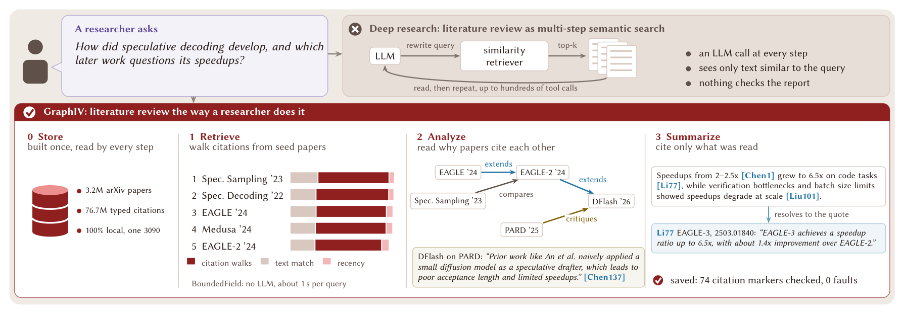

# Tools (GraphIV-MCP)

GraphIV-MCP gives an LLM agent six tools over the Model Context Protocol, built on BoundedField and GraphIV, so grounded deep research runs locally on a single consumer GPU. I designed it as if a human were doing the literature review: search for the papers a field is built on, read the ones that matter, follow who extended, compared against or critiqued whom, and cite only what was read.

The client owns the agent loop, turning the user's question into a sequence of calls, and writes the report. The server holds the corpus and the tuned recipes, answers one call at a time, logs every call into the session's run, and checks the report mechanically when the agent saves it. Nothing on the server decides what to search next or when to stop. My agent is an open-weight fine-tune of Qwen3.6 27B, Wordslop-Qwen3.6-27B, served through llama.cpp on the same RTX 3090 as the server's own reader, with no paid API call anywhere.

The code is [`src/mcp/`](../src/mcp/README.md), which also covers connecting [opencode](https://opencode.ai), the client every run here was measured with.



## The Tools

| Tool | Returns |
| --- | --- |
| `recall_paper` | **a single paper** matching a description, such as a method name or what the paper did, or none. An LLM checks each candidate of the `focused` recipe against its abstract. |
| `search_papers` | **a list of papers** answering a question under one of the four [recipes](02_retrieval.md#recipes), `focused`, `survey`, `frontier` or `consensus`. A paper can replace the question, its embedding taking the question's, and an author filter keeps only their papers. |
| `read_paper` | **a list of claims** answering a question about each paper, each backed by a verbatim quote. It splits the paper into chunks, retrieves the likeliest by fused cosine and BM25, and has an LLM answer from them. |
| `list_citations` | **a list of citations** of a paper, its citers or its references, each with its intent and labeled citing sentence. Filtering by intent shows who extended, compared against or critiqued a paper. |
| `trace_lineages` | **a poset** of the `extends`, `critiques` and `compares` citations among a field's past and present papers, with its longest chain, the papers argued with most and the newest positions taken, each citing sentence labeled, as [The poset](#the-poset) describes. |
| `save_report` | **a pass or a list of faults** for the agent's report before saving it. |

Every tool returns papers as one shape: id, date, title, authors, topic leaf and abstract. A filter, `{"exclude": [...], "authors": [...], "date_range": [start, end]}`, holds a recall or a search.

Each claim carries a label of the first author's surname and a run-wide count, such as [Karpukhin7]. Bare numbers let the model hand labels out in order across papers, which put most of a long report's citations on the wrong paper, while a surname makes that visible to the writer and the reader. Every citing sentence `list_citations` and `trace_lineages` return carries a label of its own, so a claim that one paper critiques another cites the sentence it rests on. The quotes stay on the server, and the agent sees the claims and their labels alone.

## The Mechanical Check

`save_report` takes the report as an object of findings, inferences, open areas, tables, coverage grids and posets, and matches strings only, so it guarantees by construction, whatever the model, that every quote exists in its paper and every cited paper was read.
Each fault names the path of the field it sits in, and the agent resends only that field as a patch.

1. Every marker resolves to a quote a reply gave.
2. Every number and every quoted phrase in a finding appears in a paragraph behind its markers.
3. Every name in a finding appears in the full text of a paper it cites, or in the title or abstract of a paper the session read.
4. Every finding cites, and no inference does.
5. A TL;DR that names a paper carries one of that paper's markers, which the saved report places beside the name.
6. An open area names a search the session ran, and one of that search's three nearest papers was read.
7. Every paper in the further reading was returned by a tool.

At `deep` effort the report must also hold a comparison table from `read_paper` with its coverage grid, a poset with at least three findings citing its sentences, a finding for every paper in the table, and the checked open areas.
It must have read the top four papers of the question's two opening searches, the first four newer papers citing the table, and the papers the poset names as argued with most and newest.

The check does not guarantee that a statement fully agrees with the sentence it cites. A run whose last save failed still shows its report, each faulted line marked unverified where it sits.

## Effort

The agent's instructions carry three effort presets, named in the question, in the [`graphiv-research`](../src/mcp/skills/graphiv-research/SKILL.md) skill. The server does not enforce them, so a run can exceed them.

| Effort | Time | Searches | Papers read |
| --- | --- | --- | --- |
| `quick` | 3 to 5 minutes | 1 or 2 | 4 to 6 |
| `standard` | About 10 minutes | 2 to 4 | 8 to 12 |
| `deep` | At most 20 minutes | Up to 12 | 12 to 24, adding a comparison table, a poset and open questions |

## What a Run Writes

A run is every call of one MCP session since its last passing `save_report`. `save_report` writes one directory under `RUNS_PATH`: `report.md`, `report.json` with the report object, `calls.jsonl` with every call's arguments, reply and timing, `state.json` with the server's state of the session, and `run.json` with the check, the papers read, every quote under its label, the tables, the posets and why each searched paper ranked, term by term. A client may add `session.json`, its own transcript. The webui ([`src/webui/`](../src/webui/README.md)) opens a run on its report, papers, process, timeline and check, and a label in the report opens the paragraph its quote came from.

## Results

These runs were measured on 2026-11-11 with an earlier version of the tools, whose `save_report` took markdown and whose `trace_lineages` sampled LeyLine paths.
I ran 21 test questions, three fields (non-ML computer science, machine learning and physics) by seven question types, once at each effort, for 63 runs. All 63 are public at [graphiv.kuroma.dev](https://graphiv.kuroma.dev), each with its report, its calls and the agent's reasoning.

| Effort | Passed | Minutes | Saves until passing | Papers read | `recall` | `search` | `read` | `list` | `trace` |
| --- | --- | --- | --- | --- | --- | --- | --- | --- | --- |
| `quick` | 21/21 | 6.7 (4.4) | 3.3 | 8.7 | 0.5 | 2.0 | 5.9 | 0.5 | 0.1 |
| `standard` | 21/21 | 12.7 (8.8) | 4.4 | 17.6 | 0.5 | 3.3 | 11.6 | 0.5 | 0.3 |
| `deep` | 21/21 | 24.9 (18.7) | 4.8 | 24.8 | 1.1 | 5.5 | 19.4 | 1.3 | 0.8 |

All 63 runs passed the mechanical check, and every measure grew with effort. Searches stayed within each preset, while papers read exceeded it at every effort, as did `deep` runs' time. A few long physics and comparison runs pulled the means well above the medians.

### Where the time went

A tool's share is the time any call of it was running on the server, so calls sent together count once, and the agent's share is the time no call was running, spent writing calls, reasoning and writing the report. Three runs are left out, as the server split their logs at a long quiet spell.

| Effort | Runs | Minutes | Reading | Searching | Other tools | Agent | Seconds per read | Minutes to first save | Minutes after |
| --- | --- | --- | --- | --- | --- | --- | --- | --- | --- |
| `quick` | 21 | 6.7 | 0.64 | 0.03 | 0.002 | 0.33 | 44 | 5.2 | 1.5 |
| `standard` | 19 | 12.5 | 0.64 | 0.02 | 0.002 | 0.35 | 41 | 10.2 | 2.3 |
| `deep` | 20 | 20.3 | 0.65 | 0.03 | 0.004 | 0.33 | 47 | 16.3 | 4.0 |

Reading took most of every run, at 41 to 47 seconds per `read_paper` call, since each read retrieves paragraphs and has the reader answer from them on the same GPU the agent runs on. The agent kept to its budget on its own: 38 of the 63 runs restated the effort's preset in their first reasoning step, and 41 said in their reasoning that they had enough. `recall_paper` found no match for 17 of its 47 calls.

### Search modes

Every search the agent ran was a BoundedField search, and the mode followed the question. Frontier questions used the `frontier` mode more than any other type, and lineage-comparison questions the `survey` mode for 74%, as what a field is built on is what a lineage traces. The `consensus` mode was never used, as no question asked for it.

| Type | Searches | `focused` | `survey` | `frontier` | `consensus` |
| --- | --- | --- | --- | --- | --- |
| Lineage | 21 | 0.38 | 0.57 | 0.05 | 0.00 |
| Comparison | 24 | 0.38 | 0.62 | 0.00 | 0.00 |
| Open | 67 | 0.37 | 0.46 | 0.16 | 0.00 |
| Frontier | 31 | 0.42 | 0.32 | 0.26 | 0.00 |
| Lineage-comparison | 19 | 0.26 | 0.74 | 0.00 | 0.00 |
| Frontier-open | 34 | 0.71 | 0.24 | 0.06 | 0.00 |
| Frontier-comparison | 31 | 0.74 | 0.23 | 0.03 | 0.00 |

### Faults

61 of the 63 runs failed their first save, with 683 faults between them, and passed after 4.2 saves on average. A reply lists a limited number of faults by kind, so the kinds sum to less than the total.

| Fault | First save | All failed saves |
| --- | --- | --- |
| Statement with no marker | 282 | 520 |
| Unknown marker | 42 | 83 |
| Number not in its paragraph | 112 | 344 |
| Name not in the papers cited | 89 | 167 |
| Quote not in its paragraph | 7 | 18 |
| Paper cited but never read | 7 | 16 |
| Search claimed but never run | 13 | 22 |
| TL;DR over 40 words | 54 | 61 |
| All faults | 683 | 1374 |
| Runs failing their first save | 61 |  |

The commonest faults were unlabeled statements and numbers absent from the paragraph their label points to, each a claim the agent wrote without support and had to fix or remove before saving. Seven runs answered a failed first save with new searches, and ten with new reads, rather than only rewording. [This deep run](https://graphiv.kuroma.dev/#/run/2026-11-11-104945-what-are-the-modern-methods-for-aligning-language) on aligning language models without a reward model shows it call by call: its first save failed with 15 faults over 50 markers, including two searches the report described but the agent had never run, and it passed on its third save with 58 markers, 11.7 minutes in.

## Running It

```sh
uv run python scripts/serve.py --http --role api          # the six tools, at http://127.0.0.1:6767/mcp
uv run python scripts/serve.py --http --role frontend     # the webui over saved runs, at http://127.0.0.1:6969
claude mcp add --transport http graphiv http://127.0.0.1:6767/mcp
```

The server needs the store of [`01_preprocessing.md`](01_preprocessing.md), the citation graph export, an embedding endpoint serving nomic-embed-text-v2-moe through llama-server, and any OpenAI-compatible chat endpoint for the reader and `recall_paper`. Every prompt the tools send is a markdown file under [`src/mcp/prompts/`](../src/mcp/prompts). On NixOS, `services.graphiv` runs the store, the tools, the webui and the manager as units, and [`nix/README.md`](../nix/README.md) is its page.

## The poset

A ranking, however good, is still a static list, and research needs a story: where an idea comes from, who argues with it, and where it stands today.
`trace_lineages` draws that story from the citation intents, as a poset: the sub-DAG of the citation graph whose edges are `extends`, `critiques` and `compares` citations among a field's past and present papers.
The code is [`src/mcp/lineages.py`](../src/mcp/lineages.py), and its queries are in [`src/miner/store.py`](../src/miner/store.py).

### Building it

| Part | What it holds |
| --- | --- |
| past | a `survey` search of the caller's phrase, 50 papers, plus papers the caller names, like the one the question is about |
| present | a `focused` search of the same phrase over the last 730 days, 50 papers |
| reads | every paper the session read |
| added | up to 30 papers outside the set that cite 3 or more of it with an intent, closest to the question first |
| edges | every labeled citation among those papers with one of the three intents, newer citing older, one per pair, critiques over extends over compares |

`background` and `uses` citations are left out: on the five questions measured, `uses` was about 40% of the edges, mostly pointing at model reports and datasets, and leaving it out kept every poset connected.
One hop is enough, since adding the papers between the past and the present two hops apart added 69 to 289 papers and connected nothing one hop missed.

### What the reply gives

1. The chain whose papers' closeness to the question, above the poset's median, sums highest, oldest first, so it starts where the papers turn to the question rather than at the oldest hub.
2. The papers the session's reads critique or extend most, then the ones the whole poset argues with most weighted by closeness, each with up to four of the later sentences on it, one intent at a time.
3. The newest papers closest to the question and the earlier work each takes a position on.
4. The added papers, which are leads to read.

Every sentence shown carries a label, so the report can write "Zoology critiques Hungry Hungry Hippos for insufficient data-dependent mixing" and cite Zoology's own sentence.
At `deep` effort the first call fixes required reads, the four papers argued with most and the four newest papers taking a position, so the report reads where each debate starts and where it stands now.
A lineage block places the poset in the report, drawn on the papers a section discusses with the papers joining them, and the webui's Timeline tab shows the whole poset with every citing sentence a click away.

### Against the earlier lineages and Consensus

| Run | Earlier `trace_lineages` | Poset |
| --- | --- | --- |
| EvalGen follow-ups | 3 paths of 3 papers, none through EvalGen | one connected part holding EvalGen with 4 extends, 3 compares and 1 critiques among the papers read |

On "Do state space models like Mamba match transformers on language modeling, and where do they still fall short?", Consensus cited 41 arXiv papers with 68 extends, critiques or compares pairs among them, and its answer used none of them.
The poset holds those relations, such as three later papers critiquing the 8B empirical study Consensus calls its anchor.

### Related work

- Main path analysis (Hummon and Doreian, 1989) traces a field along the single citation path with the highest traversal count, while the poset keeps every argued citation and lets the reader follow any of them.
- Intermediacy ([arXiv:1812.08259](https://arxiv.org/abs/1812.08259)) measures how much a publication lies on paths between two others, which the poset's added papers approximate by counting how many of the set each one argues with.

## Limitations

- The agent was tested on 21 questions, once per effort, with one model, and no human expert rated the reports.
- The check matches strings, so a report can quote a real sentence and still overstate it.
- A poset has no ground truth, and its sizes and cuts were set by reading the posets of five questions and comparing three runs against Consensus.
- Every intent comes from GraphIV's DistilBERT labeler, so a mislabeled citation adds or drops an edge.
- The added papers are ranked by closeness to the caller's phrase, so a phrase naming a model family pulls in its spin-offs in other domains.
