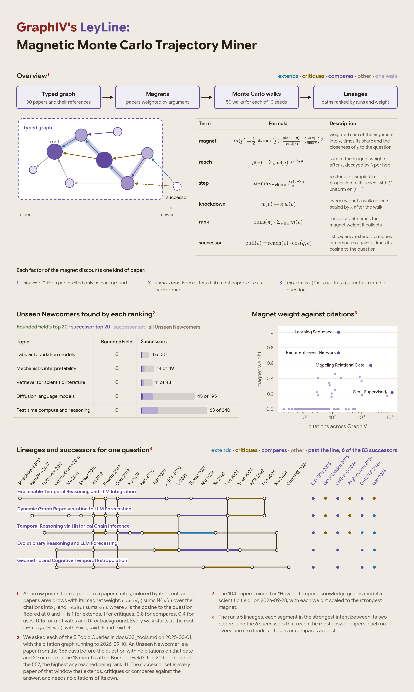

# Tools (GraphIV-MCP)

GraphIV-MCP gives an LLM agent six tools over the Model Context Protocol, built on BoundedField and GraphIV, so grounded deep research runs locally on a single consumer GPU. I designed it as if a human were doing the literature review: search for the papers a field is built on, read the ones that matter, follow who extended, compared against or critiqued whom, and cite only what was read.

The client owns the agent loop, turning the user's question into a sequence of calls, and writes the report. The server holds the corpus and the tuned recipes, answers one call at a time, logs every call into the session's run, and checks the report mechanically when the agent saves it. Nothing on the server decides what to search next or when to stop. My agent is an open-weight fine-tune of Qwen3.6 27B, Wordslop-Qwen3.6-27B, served through llama.cpp on the same RTX 3090 as the server's own reader, with no paid API call anywhere.

The code is [`src/mcp/`](../src/mcp/README.md), which also covers connecting [opencode](https://opencode.ai), the client every run here was measured with.


## The Tools

| Tool | Returns |
| --- | --- |
| `recall_paper` | **a single paper** matching a description, such as a method name or what the paper did, or none. An LLM checks each candidate of the `focused` recipe against its abstract. |
| `search_papers` | **a list of papers** answering a question under one of the four [recipes](02_retrieval.md#recipes), `focused`, `survey`, `frontier` or `consensus`. A paper can replace the question, its embedding taking the question's, and an author filter keeps only their papers. |
| `read_paper` | **a list of claims** answering a question about each paper, each backed by a verbatim quote. It splits the paper into chunks, retrieves the likeliest by fused cosine and BM25, and has an LLM answer from them. |
| `list_citations` | **a list of citations** of a paper, its citers or its references, each with its intent and labeled citing sentence. Filtering by intent shows who extended, compared against or critiqued a paper. |
| `trace_lineages` | **a list of lineages** through a set of papers, typically a whole search, following `extends`, `compares` and `critiques` citations, each line oldest first with its labeled citing sentences, by [LeyLine](#leyline). |
| `save_report` | **a pass or a list of faults** for the agent's report before saving it. |

Every tool returns papers as one shape: id, date, title, authors, topic leaf and abstract. A filter, `{"exclude": [...], "authors": [...], "date_range": [start, end]}`, holds a recall or a search.

Each claim carries a label of the first author's surname and a run-wide count, such as [Karpukhin7]. Bare numbers let the model hand labels out in order across papers, which put most of a long report's citations on the wrong paper, while a surname makes that visible to the writer and the reader. Every citing sentence `list_citations` and `trace_lineages` return carries a label of its own, so a lineage claim cites the sentence it rests on. The quotes stay on the server, and the agent sees the claims and their labels alone.

## The Mechanical Check

`save_report` matches strings only, so it guarantees by construction, whatever the model, that every quote exists in its paper and every cited paper was read:

1. every label resolves to a quote a read returned,
2. every number on a cited line appears in the paragraph behind its label,
3. every name on a cited sentence appears in the full text of a paper it cites,
4. every paper cited in the body was read, and every search the report describes was run,
5. every sentence of 12 or more words carries a label or begins with "Inference",
6. a report may open on a TL;DR of one sentence of at most 40 words, which must cite.

It does not guarantee that a statement fully agrees with the sentence it cites. A run whose last save failed still shows its report, each faulted line marked unverified where it sits.

## Effort

The agent's instructions carry three effort presets, named in the question, in the [`graphiv-research`](../src/mcp/skills/graphiv-research/SKILL.md) skill. The server does not enforce them, so a run can exceed them.

| Effort | Time | Searches | Papers read |
| --- | --- | --- | --- |
| `quick` | 3 to 5 minutes | 1 or 2 | 4 to 6 |
| `standard` | About 10 minutes | 2 to 4 | 8 to 12 |
| `deep` | At most 20 minutes | Up to 6 | 12 to 20, adding a comparison table, lineages and open questions |

## What a Run Writes

A run is every call of one MCP session since its last passing `save_report`. `save_report` writes one directory under `RUNS_PATH`: `report.md`, `calls.jsonl` with every call's arguments, reply and timing, and `run.json` with the check, the papers read, every quote under its label, the tables, the lineages and why each searched paper ranked, term by term. A client may add `session.json`, its own transcript. The webui ([`src/webui/`](../src/webui/README.md)) opens a run on its report, papers, process, timeline and check, and a label in the report opens the paragraph its quote came from.

## Results

I ran 21 test questions, three fields (non-ML computer science, machine learning and physics) by seven question types, once at each effort, for 63 runs. All 63 are public at [graphiv.kuroma.dev](https://graphiv.kuroma.dev), each with its report, its calls and the agent's reasoning.

| Effort | Passed | Minutes | Saves until passing | Papers read | `recall` | `search` | `read` | `list` | `trace` |
| --- | --- | --- | --- | --- | --- | --- | --- | --- | --- |
| `quick` | 21/21 | 6.7 (4.4) | 3.3 | 8.7 | 0.5 | 2.0 | 5.9 | 0.5 | 0.1 |
| `standard` | 21/21 | 12.7 (8.8) | 4.4 | 17.6 | 0.5 | 3.3 | 11.6 | 0.5 | 0.3 |
| `deep` | 21/21 | 24.9 (18.7) | 4.8 | 24.8 | 1.1 | 5.5 | 19.4 | 1.3 | 0.8 |

All 63 runs passed the mechanical check, and every measure grew with effort. Searches stayed within each preset, while papers read exceeded it at every effort, as did `deep` runs' time. A few long physics and comparison runs pulled the means well above the medians.

### Where the time went

A tool's share is the time any call of it was running on the server, so calls sent together count once, and the agent's share is the time no call was running, spent writing calls, reasoning and writing the report. Three runs are left out, as the server split their logs at a long quiet spell.

| Effort | Runs | Minutes | Reading | Searching | Other tools | Agent | Seconds per read | Minutes to first save | Minutes after |
| --- | --- | --- | --- | --- | --- | --- | --- | --- | --- |
| `quick` | 21 | 6.7 | 0.64 | 0.03 | 0.002 | 0.33 | 44 | 5.2 | 1.5 |
| `standard` | 19 | 12.5 | 0.64 | 0.02 | 0.002 | 0.35 | 41 | 10.2 | 2.3 |
| `deep` | 20 | 20.3 | 0.65 | 0.03 | 0.004 | 0.33 | 47 | 16.3 | 4.0 |

Reading took most of every run, at 41 to 47 seconds per `read_paper` call, since each read retrieves paragraphs and has the reader answer from them on the same GPU the agent runs on. The agent kept to its budget on its own: 38 of the 63 runs restated the effort's preset in their first reasoning step, and 41 said in their reasoning that they had enough. `recall_paper` found no match for 17 of its 47 calls.

### Search modes

Every search the agent ran was a BoundedField search, and the mode followed the question. Frontier questions used the `frontier` mode more than any other type, and lineage-comparison questions the `survey` mode for 74%, as what a field is built on is what a lineage traces. The `consensus` mode was never used, as no question asked for it.

| Type | Searches | `focused` | `survey` | `frontier` | `consensus` |
| --- | --- | --- | --- | --- | --- |
| Lineage | 21 | 0.38 | 0.57 | 0.05 | 0.00 |
| Comparison | 24 | 0.38 | 0.62 | 0.00 | 0.00 |
| Open | 67 | 0.37 | 0.46 | 0.16 | 0.00 |
| Frontier | 31 | 0.42 | 0.32 | 0.26 | 0.00 |
| Lineage-comparison | 19 | 0.26 | 0.74 | 0.00 | 0.00 |
| Frontier-open | 34 | 0.71 | 0.24 | 0.06 | 0.00 |
| Frontier-comparison | 31 | 0.74 | 0.23 | 0.03 | 0.00 |

### Faults

61 of the 63 runs failed their first save, with 683 faults between them, and passed after 4.2 saves on average. A reply lists a limited number of faults by kind, so the kinds sum to less than the total.

| Fault | First save | All failed saves |
| --- | --- | --- |
| Statement with no marker | 282 | 520 |
| Unknown marker | 42 | 83 |
| Number not in its paragraph | 112 | 344 |
| Name not in the papers cited | 89 | 167 |
| Quote not in its paragraph | 7 | 18 |
| Paper cited but never read | 7 | 16 |
| Search claimed but never run | 13 | 22 |
| TL;DR over 40 words | 54 | 61 |
| All faults | 683 | 1374 |
| Runs failing their first save | 61 |  |

The commonest faults were unlabeled statements and numbers absent from the paragraph their label points to, each a claim the agent wrote without support and had to fix or remove before saving. Seven runs answered a failed first save with new searches, and ten with new reads, rather than only rewording. [This deep run](https://graphiv.kuroma.dev/#/run/2026-11-11-104945-what-are-the-modern-methods-for-aligning-language) on aligning language models without a reward model shows it call by call: its first save failed with 15 faults over 50 markers, including two searches the report described but the agent had never run, and it passed on its third save with 58 markers, 11.7 minutes in.

## Running It

```sh
uv run python scripts/serve.py --http --role api          # the six tools, at http://127.0.0.1:6767/mcp
uv run python scripts/serve.py --http --role frontend     # the webui over saved runs, at http://127.0.0.1:6969
claude mcp add --transport http graphiv http://127.0.0.1:6767/mcp
```

The server needs the store of [`01_preprocessing.md`](01_preprocessing.md), the citation graph export, an embedding endpoint serving nomic-embed-text-v2-moe through llama-server, and any OpenAI-compatible chat endpoint for the reader and `recall_paper`. Every prompt the tools send is a markdown file under [`src/mcp/prompts/`](../src/mcp/prompts). On NixOS, `services.graphiv` runs the store, the tools, the webui and the manager as units, and [`nix/README.md`](../nix/README.md) is its page.

## LeyLine

LeyLine is GraphIV's trajectory miner, and it backs `trace_lineages`. A ranking, however good, is still a static list, and I think research needs a story: where an idea comes from, what the arguments are, and where that leads us today. A ranking built on citations alone is temporally static, while the citation intents, like `extends` or `critiques`, let me sample those stories out of a list of retrieved papers.

The name references Fate/Type-Moon's ley lines, the grid of magical power that runs from node to node. Here, the power is the argument each citation made, and it runs inside the field [BoundedField](02_retrieval.md) draws.



The code is [`src/miner/`](../src/miner/README.md). [`leyline.py`](../src/miner/leyline.py) is the algorithm on a typed graph and knows nothing about papers, so [`tests/miner/test_leyline.py`](../tests/miner/test_leyline.py) runs it on a hand-built graph with no store and no GPU, and [`miner.py`](../src/miner/miner.py) is what feeds it citations. Every constant below is in the `[miner]` block of [`config.toml`](../config.toml).

A **lineage** is a chain of papers, oldest first, in which each paper cites the one before it, running through the papers a field takes a position on rather than the ones it only names. Following one tells how an idea developed: a method, the works that extended it, and the ones that critiqued or compared against those, up to the present. As 69.1% of citations are `background`, a chain of plain citations mostly passes through the surveys and tools every paper cites, so LeyLine weighs each paper by the intents it is cited with, which keeps the chain on the papers that moved the idea.

### The typed graph

> **Definition (typed graph).** A typed graph is $G = (V, E)$ with $E \subseteq V \times V \times I$, where $(c, p, i) \in E$ means $c$ cites $p$ with intent $i$. $V$ is the first 30 papers of a search together with everything they cite, and each node $v$ carries its closeness $s(v) = \max(\cos(q, v), 0)$ to the question $q$ and a date.

Papers a reader kept rarely cite each other, and the papers a field argues with are the ones they all cite, which is why the list is expanded by what it cites.

### Magnets

A **magnet** is a paper the field takes a position on, rather than one it merely names.

> **Definition (magnet).** With intent weights $W_i$ of 1.0 for `extends` and `critiques`, 0.8 for `compares`, 0.4 for `uses`, 0.15 for `motivates` and 0 for `background`,
> $$m(p) = \frac{1}{Z}\, \text{stance}(p) \cdot \frac{\text{stance}(p)}{\text{total}(p)} \cdot \left(\frac{s(p)}{\max_{v} s(v)}\right)^{\phi}$$
> where $\text{stance}(p) = \sum_{(c,p,i) \in E} W_i\, s(c)$, $\text{total}(p) = \sum_{(c,p,i) \in E} s(c)$, $Z$ scales the strongest magnet to 1, and $\phi = 4$.

| Factor | What it removes |
| --- | --- |
| $\text{stance}(p)$ | A paper nobody takes a position on, however often it is named |
| $\text{stance}(p) / \text{total}(p)$ | A paper cited as background by everything, which is the generic hub |
| $(s(p) / \max s)^{\phi}$ | A paper argued about for a reason other than the question |

The closeness enters as a power and not as a factor, since at a power of one a backbone paper the whole pool cites outranks the field's own landmarks. On a question about temporal knowledge graphs, the most cited papers in the graph were not its strongest magnets:

| Paper | Citations across GraphIV | Magnet weight |
| --- | --- | --- |
| Learning Sequence Encoders for Temporal Knowledge Graph Completion | 161 | **1.000** |
| Recurrent Event Network | 162 | 0.733 |
| Modeling Relational Data with Graph Convolutional Networks | 2,093 | 0.569 |
| Semi-Supervised Classification with Graph Convolutional Networks | 11,675 | 0.219 |
| Inductive Representation Learning on Large Graphs | 7,260 | 0.214 |
| Graph Attention Networks | 8,006 | 0.174 |

### Reach

> **Definition (reach).** For magnet weights $w$, starting at $m$, the reach $\rho(v) = \sum_{u : w(u) > 0} w(u)\, \lambda^{h(v,u)}$ is the magnet mass reachable forward in time from $v$, where $h(v,u)$ is the fewest citation hops from $u$ back to $v$ and $\lambda = 0.5$.

Without the discount, a magnet six hops away counts as much as an adjacent one, and every walk would start at the oldest paper in the graph, since it reaches all of them.

### Lineages

> **Algorithm (lineages).** For each seed $1, \dots, S$, reset $w \gets m$, then run $T$ walks:
> 1. Start at $v = \arg\max_{u : \rho(u) > 0,\, w(u) > 0} \rho(u)\, w(u)$.
> 2. Among the papers citing $v$ with $\rho > 0$, draw the next one with probability proportional to its $\rho$ (Efraimidis and Spirakis, 2006), and repeat until none is left.
> 3. Count one more run of the path, knock down every magnet it collected, $w(u) \gets \kappa\, w(u)$, and recompute $\rho$.
>
> Then drop every path another path contains, and rank the rest by $\text{runs}(\pi) \cdot \sum_{u \in \pi} m(u)$.

Here $S = 10$ seeds, $T = 50$ walks per seed and $\kappa = 0.4$. A walk starts where the most argued-with mass is reachable, since rooting on reach alone would start every path at the oldest node again. The knockdown sends the next walk to a part of the graph the last one left alone, and as every seed fixes the sampler, the same graph always returns the same lineages.

### Successors

The lineages look backward, so LeyLine also returns **successors**, in `Miner.successors`.

> **Definition (successor).** A successor is a paper outside the search, dated within 240 days before the cap, that `extends`, `critiques` or `compares` against at least one paper of the search with an intent score of at least 0.60, ranked by the number of such papers times its cosine to the question.

A successor needs no citations of its own, which reaches the brand new papers that BoundedField's citation terms cannot. The miner also returns disputes, one citing sentence per pair that took a position, and connectors, papers outside the list sitting on a short path between two papers in it.

### Evaluation

No document lists a field's lineages to score against, so the walk's design was settled by reading the lineages it produced. What can be measured is the cold start, by asking at a date in the past and scoring against what happened after. Five Topic Queries were asked on 2025-03-01, with the citation graph running to 2026-09-10. An **Unseen Newcomer** is a paper of the 365 days before the question with no citations at the question date and 20 or more in the 18 months after.

| Topic | Unseen Newcomers | BoundedField's top 20 | Successor top 20 | Successor set |
| --- | --- | --- | --- | --- |
| Tabular foundation models | 30 | 0 | 2 | 3 |
| Mechanistic interpretability | 49 | 0 | 5 | 14 |
| Retrieval for scientific literature | 43 | 0 | 4 | 11 |
| Diffusion language models | 195 | 0 | 7 | 45 |
| Test-time compute and reasoning | 240 | 0 | 2 | 63 |
| **all** | **557** | **0** | **20** | **136** |

The best rank any Unseen Newcomer reached in BoundedField's ranking was 41, and the median citation count the successor top 20 held at the question date was 0 for every topic. Each Topic Query is written as a researcher saying what they already know and what they are trying to decide:

| Topic | Topic Query |
| --- | --- |
| Tabular foundation models | I work on tabular prediction and I have been away from the literature for about a year. I know TabPFN and the in-context learning story behind it, and I know gradient boosting is still the thing to beat on real datasets. I am trying to decide whether prior-fitted networks are now good enough to put in a production pipeline, or whether the whole line is still a benchmark curiosity. What has actually changed, and who is pushing it forward right now? |
| Mechanistic interpretability | I am a safety researcher moving into mechanistic interpretability from RL. I have read the induction heads work and the sparse autoencoder papers, and I understand superposition as the motivating problem. I want to know what the field is actually doing now rather than what it was doing two years ago, and specifically whether sparse autoencoders are still the main tool or whether something replaced them. What should I read to be current, and what is still unsolved? |
| Retrieval for scientific literature | I am building a system that finds the papers a literature review should cite, over a few million arXiv papers, running on one consumer GPU. I know dense retrieval with a scientific embedding model, and I know the LLM reranking line of work. I am trying to decide whether the citation graph is a useful signal at query time or whether everyone has settled on baking it into the embedding at training time. What is the current state, and where are the open problems? |
| Diffusion language models | I work on efficient inference for language models and I keep seeing diffusion language models claimed as an alternative to autoregressive decoding. I know the discrete diffusion formulation and I have read the early masked diffusion papers. I want to know whether these have closed the quality gap with autoregressive models at a comparable scale, and what the current bottleneck is. Who is doing the serious work here now? |
| Test-time compute and reasoning | I am a graduate student starting on reasoning in language models. I know chain of thought prompting and I know the basic idea that sampling more and verifying buys accuracy. I want to understand where the field currently draws the line between training a reasoner and spending compute at inference, and which of the two is winning. What is the frontier and what is still argued about? |

### Related work

- Main path analysis (Hummon and Doreian, 1989) traces a field's development along the citation path with the highest traversal count. LeyLine instead weights papers by how much the field argues with them and samples many paths toward that mass, keeping the distinct paths rather than the single heaviest one.
- Randomized shortest paths (Saerens et al., 2009) and the betweenness measures built on them ([arXiv:1509.03147](https://arxiv.org/abs/1509.03147), [arXiv:1210.4276](https://arxiv.org/abs/1210.4276)) sample paths between two chosen endpoints. A LeyLine walk has no target, and its steps depend only on the mass reachable ahead.
- Intermediacy ([arXiv:1812.08259](https://arxiv.org/abs/1812.08259)) measures how much a publication lies on paths between two others, which is the question LeyLine's connectors answer by enumeration.

## Limitations

- The agent was tested on 21 questions, once per effort, with one model, and no human expert rated the reports.
- The check matches strings, so a report can quote a real sentence and still overstate it.
- Lineages have no ground truth, and the walk's constants were set by reading the lineages rather than by a score.
- Every intent comes from GraphIV's DistilBERT labeler, so a mislabeled citation moves a magnet.
- The cold-start measurement is five questions on one date, and the successor set it reports is a reach, not a ranking that put the Unseen Newcomers on top.
